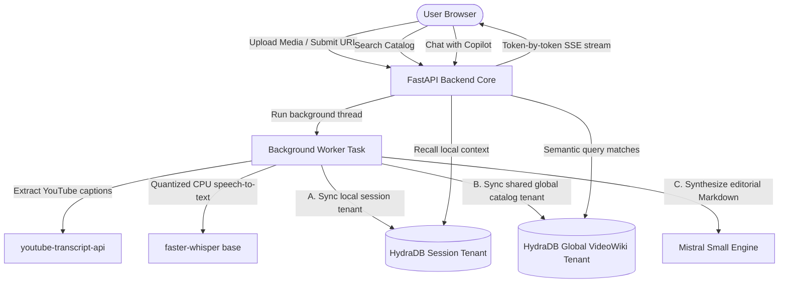

# 📖 VideoWiki — SOTA Video Wikipedia Engine

VideoWiki is a state-of-the-art, high-density video knowledge engine. It automatically transcribes and compiles YouTube videos or local media files into gorgeous, flowing Wikipedia-style editorial articles. Built with a floated InfoBox layout and a collapsing **AI Research Assistant** sidebar, VideoWiki makes video catalogs completely searchable, queryable, and readable in seconds.


---

## 🚀 SOTA Tech Stack Architecture



---

## ⚡ Setup & Ingestion Engine

### 1. Pre-requisites
Make sure you have **Python 3.10+** (3.11 recommended) and `pip` installed, or just **Docker**.

### 2. Environment Variables Config
Copy `videomind/.env.example` to `videomind/.env` and fill in your keys:
```ini
MISTRAL_API_KEY=your_mistral_api_key
HYDRADB_API_KEY=your_hydradb_api_key   # optional, enables semantic memory + global search
DATABASE_URL=sqlite:///videomind.db    # relative SQLite paths live in videomind/instance/
```

### 3a. Run with Docker (recommended for deployment)
From the repository root:
```bash
docker compose up --build
# or, without compose:
docker build -t videomind .
docker run -p 8000:8000 --env-file videomind/.env -v videomind-data:/data videomind
```
The image bakes in the `faster-whisper` "base" model (skip with `--build-arg PRELOAD_WHISPER=false`), stores the SQLite DB and temporary uploads in the `/data` volume, honours the `PORT` env var used by most PaaS hosts, and exposes a `/healthz` health check.

### 3b. Run locally
```bash
cd videomind
pip install -r requirements.txt
uvicorn app:app --reload        # or: python app.py
```
> [!NOTE]
> When uploading your first local MP4, MP3, or WAV file, the system will trigger a one-time automated download of the standard local `faster-whisper` "base" model (~150MB).

Open **[http://127.0.0.1:8000](http://127.0.0.1:8000)** in your browser. Interactive API docs are at `/docs`.

> [!IMPORTANT]
> Run a **single worker process** (the default above). Ingestion progress is tracked in process memory, so multiple workers would break the live progress stream.

---

## 🧠 SOTA Semantic Memory: The HydraDB Architecture

VideoWiki uses a advanced dual-layered vector indexing architecture powered by **HydraDB** to unlock both local deep-dives and global cross-video search:

### 1. Local Session Isolated Tenants (`session_id` tenant)
*   **Context Isolation**: Each individual video is registered with a dedicated, isolated UUID tenant on HydraDB.
*   **Focused Memory**: Chat queries made inside a specific article are matched solely against that video's transcript chunks. This prevents semantic leaks and keeps the AI copilot highly focused.

### 2. Global Shared Catalog Tenant (`global_videowiki_tenant` tenant)
*   **Cross-Video Semantic Index**: Transcript slices from *every* successfully indexed video are cataloged in a shared multi-video index.
*   **Search Engine Capabilities**: Entering a query into the global homepage search box semantically retrieves relevant moments from across the entire video catalog, complete with clickable links that take you directly to those specific video pages!

---

## 🛡️ Robust Fail-Safe Design

VideoWiki is built to guarantee a bulletproof user experience even during API outages or background task delays:

*   **Failsafe On-The-Fly Article Compilation**: If a user clicks an older session where article synthesis wasn't fully completed, the backend kicks off a background job that compiles the structured Wikipedia-style article with `mistral-small-latest` and caches it in the SQLite database, so the page never blocks on the LLM. Refresh to see it.
*   **Offline Context Windowing**: If HydraDB becomes unreachable or rate-limited, the AI Research Assistant automatically falls back to an offline windowing algorithm. It extracts the densest section of the transcript, and feeds it directly into Mistral to maintain a high-quality conversation without interruption.

---

## 💎 Elite Design System & Editorial Layouts

VideoWiki's user experience matches the quality of a world-class, premium publishing portal:

*   **Wolfram-style Wikipedia Portal**: Homepage features high-contrast logo glows, side-by-side symmetrical YouTube & Local upload cards, and a sleek central search dashboard with quick-click trending concept badges.
*   **Direct Editorial Article Canvas**: Main view floats a highly stylized **Quick Facts & Metadata InfoBox** inside the text, allowing the synthesized technical Markdown headers (*Executive Summary, Key Thematic Concepts, Timeline*) to wrap beautifully around it.
*   **Collapsible Research Copilot**: A right-side AI chat panel is pinned to the page. Readers can collapse the panel to read in full-screen mode, which prompts a scale-animated "**Ask Assistant**" floating button to pop up at the bottom-right for instant retrieval!
